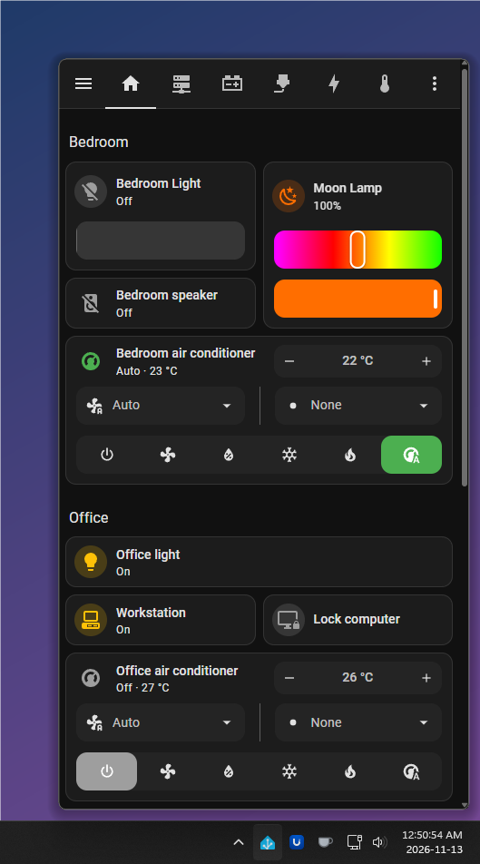
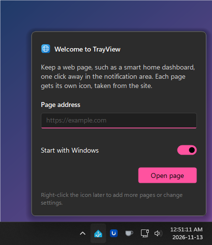
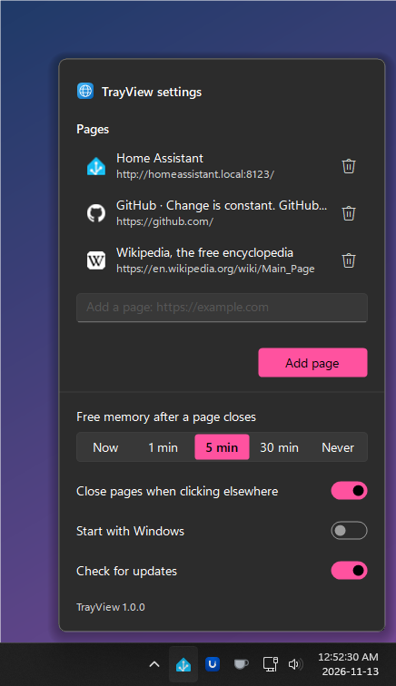

# TrayView

**Your favorite web pages, one click away in the Windows notification area.**

Each page gets its own icon next to the clock, taken from the site itself. Click it and the page opens in a small window about the size of a phone screen, sliding in like Windows 11's own panels. Click again, click elsewhere or press Esc, and it's gone.

It's made for the pages you check all the time: a smart home dashboard, a server status page, a to-do list.

## Why TrayView

- **Tiny.** One exe under 100 KB. It uses what Windows 11 already has, including the Edge browser engine, so there's nothing else to download.
- **Light on memory.** A closed page is freed after a while (you choose how long), so pages you aren't looking at cost nothing. Idle, TrayView uses about 5 MB.
- **Fast when it matters.** Pointing at an icon starts loading its page, so it's usually ready by the time you click.
- **Feels like Windows 11.** Light and dark mode, your accent color, rounded corners, smooth animations, sharp at any display scale, and it works with the taskbar on any side.
- **Stays signed in.** Cookies and sign-ins are kept like in a normal browser.

## Download

Get **[TrayView-Setup.exe](../../releases/latest)** and run it. It installs TrayView for your account, with no administrator rights needed, and adds it to the Start menu. The same download runs natively on regular (x64) and ARM64 PCs.

TrayView needs Windows 11, or Windows 10 with the [WebView2 Runtime](https://go.microsoft.com/fwlink/p/?LinkId=2124703) (most Windows 10 PCs already have it).

**Updates:** when a new version is out, the settings show a notice. Click **Update** and TrayView downloads and installs it, keeping your pages and settings.

**Uninstall:** go to **Settings > Apps > Installed apps**. This also removes your pages, settings and browser data.

## Getting started

The first time you run TrayView, it asks for the address of a page and whether it should start with Windows. That's all.

- **Click a page's icon** to open it. Click it again, click anywhere else or press Esc to close it. Clicking another page's icon switches to that page.
- **Resize** a page by dragging its edges or the corner away from the clock. Each page remembers its own size.
- **Right-click** an icon to reload the page, open it in your browser, copy its address or open the settings.

New icons may start among the hidden icons (the **^** arrow next to the clock). Drag them onto the taskbar to keep them in sight.

 

## Settings

Right-click any TrayView icon and choose **Settings**.

- **Pages**: add as many as you like, each with its own icon. Click one to change its address, or remove it with the trash button.
- **Free memory after a page closes**: how long a closed page stays loaded. A loaded page opens instantly; a freed one takes a moment to load again.
- **Close pages when clicking elsewhere**: turn off to keep a page open until you press Esc or click its icon.
- **Start with Windows** and **Check for updates**.

To close TrayView, right-click an icon and choose **Exit**.

 

## Questions

**Do I have to sign in to my site every time?**
No. TrayView keeps cookies and sign-ins like a normal browser.

**Links open in my normal browser. Is that on purpose?**
Yes. Links that would open a new window go to your default browser.

**Where are my settings?**
In the registry under `HKEY_CURRENT_USER\Software\TrayView`, and the browser data in `%LOCALAPPDATA%\TrayView`. The app itself is in `%LOCALAPPDATA%\Programs\TrayView`. Uninstalling removes all three.

**Why does Windows warn me when I run the setup?**
The setup isn't code-signed, so SmartScreen may show "Windows protected your PC" the first time. Choose **More info > Run anyway**. The source is all here, and every release is built from it by [GitHub Actions](../../actions).

## License

[MIT](LICENSE). For developers: [technical notes](docs/technical.md) and [how to contribute](CONTRIBUTING.md).
